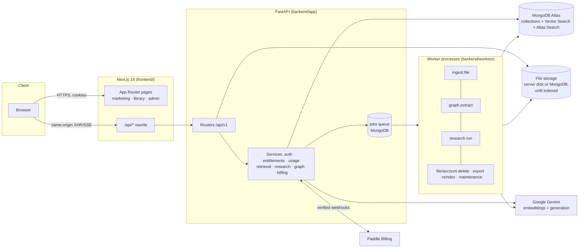

# Architecture

## Overview

Three independently deployable processes share one codebase per language:

| Process | Command | Scales by |
|---|---|---|
| Web (Next.js) | `npm run start` | CPU; stateless |
| API (FastAPI + Uvicorn) | `uvicorn app.main:app` | CPU; stateless (sessions in MongoDB) |
| Worker | `python -m workers.main` | Job volume; any number of instances, optionally restricted with `--types` |

There is no Redis, Kafka or Kubernetes requirement. The queue is a MongoDB collection with leases (below).

## Request path and trust boundary

* The browser only talks to the web origin. `/api/*` is forwarded by Next.js (or, recommended in production, by the reverse proxy) to FastAPI, so cookies are first-party.
* **The backend is the only security boundary.** Next.js route guards (`RequireSession`) only decide what to render. Every API route authenticates the session cookie, checks CSRF on unsafe methods, checks the `Origin` header, resolves the workspace membership, and filters every query by `workspace_id` (`WorkspaceContext.scope()`).
* Sessions are opaque random tokens; MongoDB stores only an HMAC hash. A separate readable `ks_csrf` cookie is echoed in `X-CSRF-Token` and bound to the session server-side.

## Backend modules (`backend/app`)

| Module | Responsibility |
|---|---|
| `core/` | typed settings (`config.py`), error model, units, time helpers |
| `database/` | `AsyncMongoClient` lifecycle, transaction detection, collections, validators, indexes (`setup.py`) |
| `auth/` | password and Google OAuth (PKCE, state, nonce, issuer/audience checks), sessions, CSRF, role and workspace dependencies |
| `security/` | Argon2id hashing, token hashing, MongoDB-backed rate limiting |
| `billing/` | plan catalog with immutable versions (`catalog.py`), entitlement resolution (`entitlements.py`), billing periods (`periods.py`), atomic usage reservations (`usage.py`), byte-accurate storage accounting and reconciliation (`storage_accounting.py`), Paddle client and webhooks |
| `documents/` | upload acceptance and streaming, content sniffing (`detect.py`), parser registry (`parsers/`), isolated parsing, structure-aware chunking, language detection, deletion |
| `storage/` | `ObjectStorage` interface; server-disk, MongoDB (GridFS) and optional S3-compatible adapters. New files go to the backend chosen in Admin > Settings; each record remembers its backend. `documents/originals.py` deletes the original once a file is indexed unless originals are kept |
| `embeddings/` | `EmbeddingProvider` interface; Gemini implementation (per-chunk `Content`, task prefixes, dimension validation) |
| `providers/` | `LLMProvider` interface; Gemini implementation; retries, circuit breaker, rate limiter; provider call telemetry and cost estimates |
| `retrieval/` | hybrid search (vector + keyword + RRF), context assembly, grounded answers with citation validation, complexity classification and compute budgets, embedding spaces and re-index migrations, Atlas index definitions |
| `research/` | bounded multi-step research agent, reports, Markdown and PDF export |
| `graph/` | entity and relationship extraction with provenance |
| `jobs/` | durable queue, worker runtime, maintenance jobs |
| `admin/` | admin metrics and reports |
| `observability/` | JSON logging with request and job context, health and readiness |
| `api/v1/` | routers: `auth`, `me`, `plans`, `library`, `ask`, `graph`, `research`, `billing`, `admin` |

## Frontend (`frontend/`)

* `app/(marketing)`: landing, features, how it works, pricing (live catalog), privacy and security, FAQ, privacy-policy template.
* `app/(auth)`: sign-in, register, forgot and reset password, verify email.
* `app/app/*`: dashboard, library (files, collections, file detail), books, documents, Ask AI (streamed SSE answers), deep research (live SSE progress with polling fallback), knowledge graph (React Flow), findings, reports, usage and billing (Paddle.js checkout), settings.
* `app/admin/*`: overview, plans and pricing (versioned editor with review step), Paddle price mapping, users, usage and costs, jobs, system health and configuration, audit and billing events.
* Data fetching uses TanStack Query against the typed client in `lib/api.ts`, which attaches CSRF, normalises errors and parses SSE.

## Data model

All tenant-owned documents carry `workspace_id` (and `owner_id`/`user_id` where relevant). Today every user has one personal workspace; the membership collection already supports team workspaces.

| Area | Collections |
|---|---|
| Identity | `users`, `sessions` (TTL), `oauth_accounts`, `oauth_states` (TTL), `email_verification_tokens` (TTL), `password_reset_tokens` (TTL) |
| Tenancy | `workspaces`, `workspace_memberships` |
| Library | `files` (one per upload; byte sizes, storage and processing status), `books` and `documents` (one per file, by kind), `collections`, `chunks` (text, location, embedding, embedding-space marker, chunking version) |
| Graph | `entities`, `relationships` (typed, with evidence chunk ids and confidence), `entity_mentions` |
| Q&A | `conversations`, `messages` (validated citation objects), `saved_searches` |
| Research | `research_projects`, `research_jobs` (runs; budget, plan, state), `reports`, `research_findings` |
| Billing | `plans`, `plan_versions` (immutable), `price_mappings`, `subscriptions`, `billing_customers`, `billing_events` (unique `event_id`), `entitlement_grants`, `webhook_rejections` |
| Metering | `usage_reservations`, `usage_events`, `usage_counters`, `provider_calls`, `reconciliation_reports` |
| Operations | `jobs`, `job_events`, `worker_heartbeats` (TTL), `idempotency_records`, `rate_limits` (TTL), `audit_events`, `data_exports`, `reindex_migrations`, `system_settings` |

`python -m app.cli setup-db` creates every collection, `$jsonSchema` validators for critical collections (users, files, usage reservations, plan versions, audit and billing events), and all indexes, including unique indexes (emails, token hashes, OAuth subjects, Paddle event ids, idempotency keys) and TTL indexes for data that is safe to expire. Large content never lives in user documents: file bytes are in object storage, and text is split across `chunks`.

**Counting rules.** A book and a document are counted by their `books` and `documents` records (one per file), never by chunks or pages. Storage is the sum of `files.original_size_bytes` for stored files, counted once per file.

## Background jobs

`jobs/queue.py` implements a durable queue on MongoDB:

* **Atomic claim:** `find_one_and_update` on `{status: queued|retrying, run_at <= now}` sorted by priority, setting `status=running`, a worker id, and `lease_expires_at`.
* **Heartbeats** extend the lease while a handler runs; a handler that loses its lease stops at its next checkpoint.
* **Recovery:** expired leases are reclaimable by any worker; jobs that exhaust `max_attempts` become `failed` (dead-letter).
* **Retries:** bounded, with exponential backoff and jitter; errors are classified retryable or permanent with structured codes.
* **Idempotent handlers:** ingestion re-uses unchanged chunks by content hash, graph extraction upserts, research resumes from persisted state, and deletion is re-entrant.
* **Cancellation:** cooperative, at checkpoints; quota reservations are released.
* **Limits:** per-worker concurrency, per-account concurrent-job limits from entitlements, and priority for plans with `priority_processing`.
* **Progress:** `job_events` with a per-job sequence number feed SSE streams and polling.
* **Maintenance:** workers enqueue `maintenance.reconcile` every 15 minutes (deduplicated across workers). It expires stale reservations, reconciles storage records against stored objects, and deletes expired data exports.

States: `queued → running → completed | retrying | failed | cancelled`.

## Retrieval pipeline

1. Authorise and resolve entitlements; reserve the question allowance atomically (released if nothing is generated).
2. Classify the operation deterministically (`simple`, `standard`, `cross_document` …) and estimate model calls, input tokens and output cap.
3. Rewrite short follow-ups deterministically with the previous question.
4. Embed the query in the **active embedding space only**.
5. Run vector search (`$vectorSearch` with `workspace_id` and space filters) and keyword search (`$search`) concurrently. Each degrades independently; degradation is reported to the user.
6. Fuse with Reciprocal Rank Fusion, drop near-duplicates (same page or high text overlap), add neighbouring chunks of top hits.
7. Fit the context to the token budget (`min(plan max input, model budget)`).
8. Generate with a system prompt that treats passages as untrusted data; stream tokens.
9. Validate every `[S#]` marker against the supplied passages; remove and log unknown ones; return citation objects (chunk id, source, page, section, snippet), never model-written URLs.
10. On provider failure, return a labelled keyword-search fallback instead of an answer.

`backend/scripts/eval_retrieval.py` measures Recall@K, MRR and citation accuracy on a labelled dataset (`eval_dataset.example.json`).

## Embedding spaces and migrations

Every chunk stores `embedding_space = provider:model:dimensions` (plus a chunking version). Search always filters on the active space, so vectors from different models are never compared. Changing model or dimensions is an explicit migration (admin panel > System): a `reindex.embed` job writes new vectors into a **separate field** with its own Atlas index while search keeps using the old one. Configuration is switched only after the migration reports complete. See [runbook.md](runbook.md#changing-the-embedding-model).

## Deep research agent

A `research.run` job with a fixed budget derived from the plan: max steps, retrieval iterations, AI calls, input and output tokens, wall time, plus daily and monthly compute and cost budgets. Phases: plan → retrieve per sub-question → critique (gaps, conflicts, coverage) → bounded follow-up → synthesise (structured JSON) → validate citations (`[E#]`) → save report. When a limit is hit, the agent stops and saves an **incomplete** report with the reason. The model never sees tools or data outside the workspace-scoped retrieval function, and it cannot change its own budget.

## Knowledge graph

`graph.extract` runs after indexing. It processes chunks in batches with JSON-schema-constrained extraction, normalises entity names, drops relationships whose endpoints aren't extracted entities, and stores evidence chunk ids for every relationship and mention. The API serves bounded subgraphs (≤150 nodes, ≤400 edges) for overview and neighbourhood expansion. The `graph/` package is the seam for a future Neo4j repository if traversal becomes a bottleneck.

## Billing and entitlements

See [billing-and-plans.md](billing-and-plans.md). In short: the plan catalog defines entitlements; Paddle is authoritative for payment state; `entitlements.resolve(account)` combines subscription, plan version snapshot, grants and the billing period. Every quota check uses atomic reservations (`usage_reservations` with idempotency keys) that are committed or released.
